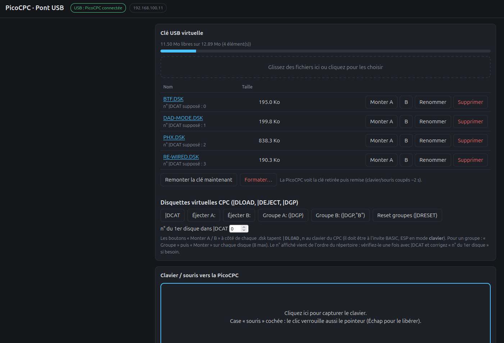
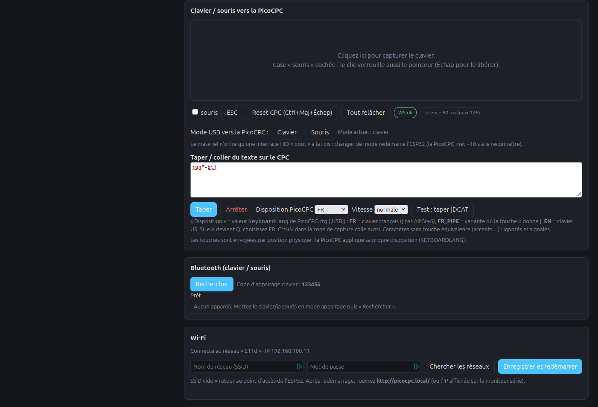
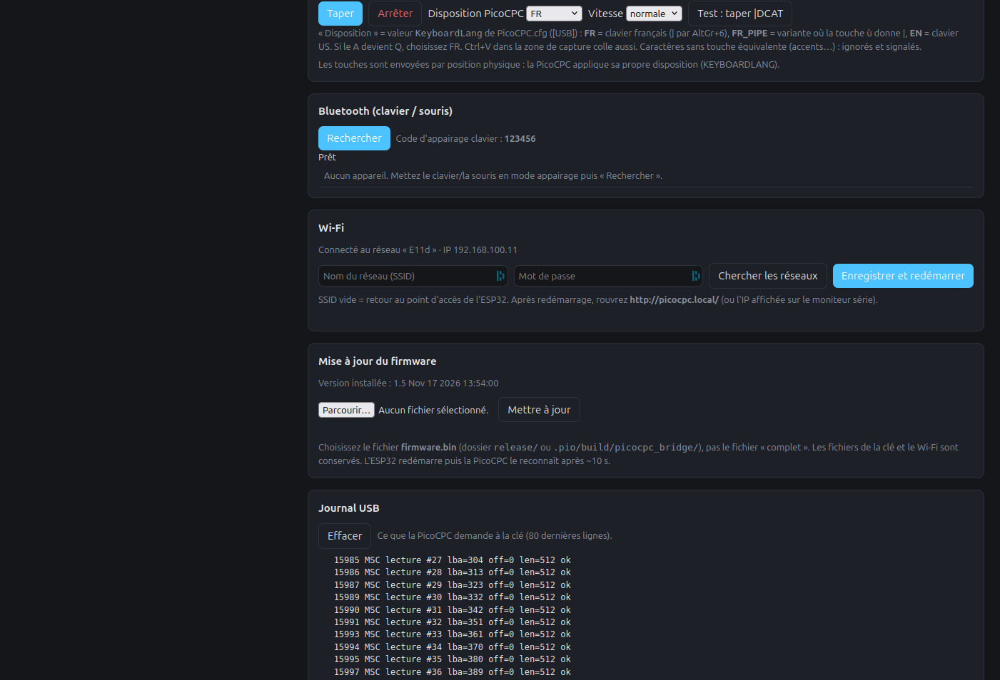

# PicoCPC USB Bridge (ESP32-S3)

Cle USB virtuelle (FAT16 en flash, ~12,9 Mo) + clavier/souris USB pour la PicoCPC,
pilotes par une page web et par Bluetooth.

1. Editer `src/config.h` (Wi-Fi, sinon l'ESP32 cree le reseau `PicoCPC-ESP32`, mdp `picocpc1234`).
2. Brancher la carte par le port **UART** au PC, `pio run -t upload`, `pio device monitor`.
3. Debrancher du PC, relier le port **USB** (natif) de la carte au port USB-A de la PicoCPC
   (cable USB-A -> USB-C donnees).
4. Ouvrir `http://192.168.4.1/` (mode AP) ou `http://picocpc.local/`.

Tests hote (PC) du disque + FAT16 : `tools/hosttest` (g++ + python3), voir `test.cpp` et `verify_fat16.py`.

## Mise à jour du firmware

* **Depuis la page web** : carte « Mise à jour du firmware » → choisir `firmware.bin` (copie dans `release/picocpc-usb-bridge-vX.Y-app.bin`) → « Mettre à jour ». L'ESP32 vérifie l'image (puce ESP32-S3), l'écrit dans l'emplacement libre et redémarre. Les fichiers de la clé et le Wi-Fi sont conservés.
* **Par câble (Windows / Linux)** : après chaque compilation, le dossier `release/` contient l'image complète, l'application seule et `flash.py` / `flash.bat` / `flash.sh`. Copiez ce dossier où vous voulez, branchez le port « UART », lancez `flash.bat` (ou `./flash.sh`). Python 3 est nécessaire ; `esptool` s'installe tout seul.
* **Partitions** : 2 emplacements d'application de 1,5 Mo (`app0`, `app1`) + `otadata` ; la partition `disk` n'a pas bougé. Si la compilation signale « program size greater than maximum allowed », il faut réduire l'application (ou la partition `disk`).
* La première fois, passez par PlatformIO (`Upload`) pour installer la nouvelle table de partitions ; ensuite tout peut se faire par la page web.

## v1.2 : disquettes, saisie de texte, réactivité

* **Monter / éjecter** : à côté de chaque `.dsk`, « Monter A » / « B » tape `|DCAT` puis `|DLOAD,n[,"B"]` au clavier du CPC. Boutons `|DCAT`, `|DEJECT` (A/B), `|DGP` (groupe A/B, puis « Monter » sur chaque disque), `|DRESET`. Le numéro `n` est celui de l'ordre du répertoire ; réglable (« n° du 1er disque »).
* **Coller du code** : zone de texte « Taper / coller du texte » ou Ctrl+V dans la zone de capture. Le navigateur convertit le texte en touches selon la disposition (`KeyboardLang` de PicoCPC.cfg : EN ou FR), l'ESP32 les rejoue avec un minutage régulier (vitesse lente/normale/rapide). Il faut le mode USB **clavier**.
* **Réactivité** : tâche dédiée (WebSocket, Bluetooth, HID) indépendante des requêtes HTTP, file d'attente de rapports sans perte, fusion des déplacements de souris, intervalle HID 4 ms, plus de scan Bluetooth inutile quand tous les appareils appairés sont connectés. La page affiche la latence WebSocket.
