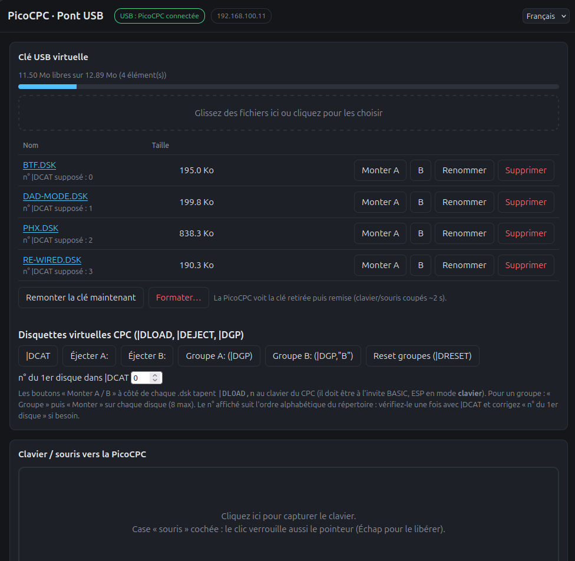
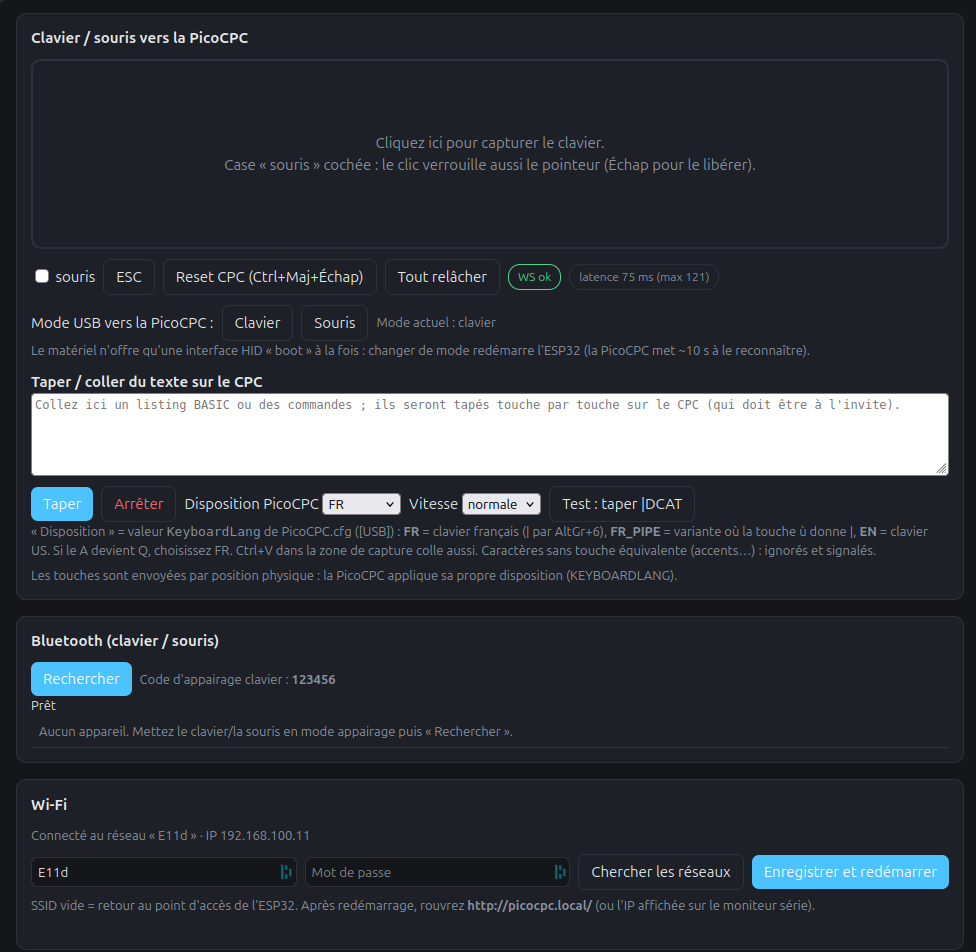
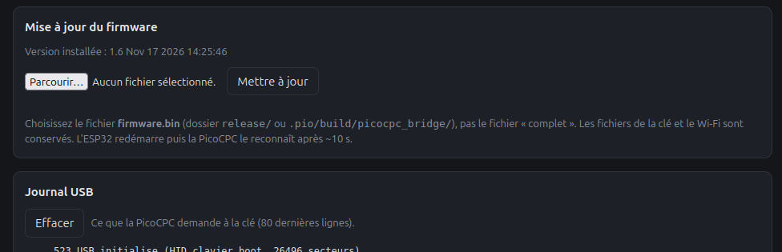

# PicoCPC USB Bridge (ESP32-S3)

[English](README.md) · [Français](README_FR.md) · **Español**

Un ESP32-S3 conectado al puerto USB-A anfitrión de una **PicoCPC** (Amstrad CPC) que le proporciona:

* una **llave USB virtual** almacenada en la flash del ESP32 (FAT16, unos 12,9 MiB): envío, renombrado y borrado de archivos desde una página web, con el espacio libre a la vista;
* un **teclado y un ratón USB** para la PicoCPC, alimentados por un teclado/ratón **Bluetooth** emparejados con el ESP32, o por una zona de captura de la página web;
* una **escritura remota**: pegue un listado BASIC o comandos en la página y el ESP32 los teclea tecla a tecla en el CPC;
* **atajos de disquetes virtuales**: « Montar A / B » junto a cada `.dsk` (teclea `|DLOAD,n`), expulsión, grupos de disquetes (`|DGP`, `|DRESET`).

La página está disponible en **español, francés e inglés** (selector arriba a la derecha).

## Capturas de pantalla







## Hardware

* ESP32-S3 **DevKitC-1 N16R8** (16 MB de flash, 8 MB de PSRAM octal).
* La placa tiene dos puertos USB-C:
  * puerto **UART**: flasheo y monitor serie (conéctelo al ordenador);
  * puerto **USB** (nativo): conéctelo al puerto USB-A de la PicoCPC con un cable **de datos** (USB-A → USB-C). La PicoCPC aporta los 5 V.
* No hace falta tarjeta microSD: todo está en la flash.

## Compilación y primer flasheo (PlatformIO / VSCodium)

1. Abra la carpeta en VSCodium/VS Code con la extensión PlatformIO.
2. Opcional: edite `src/config.h` (SSID y contraseña Wi-Fi, opciones). Sin ajustes Wi-Fi, el ESP32 crea la red **`PicoCPC-ESP32`** (contraseña `picocpc1234`).
3. Conecte el puerto **UART** al ordenador y pulse *Upload* (`pio run -t upload`). La primera vez hay que hacerlo con PlatformIO: instala la tabla de particiones (2 ranuras de firmware + la llave).
4. Desconéctelo del ordenador y una el puerto **USB** a la PicoCPC.
5. Abra `http://picocpc.local/` (o `http://192.168.4.1/` en la red propia del ESP32). El Wi-Fi se configura en la página (tarjeta « Wi-Fi »).

Tras cada compilación se genera la carpeta **`release/`** (véase más abajo).

## Actualizar el firmware

* **Desde la página web**: tarjeta « Actualización del firmware » → elija `release/picocpc-usb-bridge-vX.Y-app.bin` (o `.pio/build/picocpc_bridge/firmware.bin`) → *Actualizar*. La imagen se verifica (ESP32-S3), se escribe en la ranura libre y el ESP32 se reinicia. Se conservan los archivos de la llave y el Wi-Fi.
* **Con cable (Windows / Linux / macOS)**: copie la carpeta `release/` donde quiera, conecte el puerto **UART** y ejecute `flash.bat` (Windows) o `./flash.sh` (Linux/macOS). Se necesita Python 3; `esptool` se instala solo la primera vez. `flash.py --app` flashea solo la aplicación; `flash.py --erase` borra **todo** (incluida la llave y el Wi-Fi).

## Usar la página web

| Tarjeta | Función |
| --- | --- |
| **Llave USB virtual** | Arrastrar y soltar archivos, descargar / renombrar / eliminar, espacio libre, *Remontar ahora* (la PicoCPC ve la llave desconectada y vuelta a conectar y la relee), *Formatear*. Los archivos se ordenan alfabéticamente, como en `|DCAT`. |
| **Disquetes virtuales CPC** | `|DCAT`, expulsar A:/B:, grupo A:/B: (`|DGP`), reiniciar grupos (`|DRESET`). « Montar A / B » junto a un `.dsk` teclea `|DLOAD,n[,"B"]`. « N.º del 1.er disco en `|DCAT` » vale `0` por defecto. |
| **Teclado / ratón** | Haga clic en la zona para capturar su teclado (marque *ratón* para capturar también el puntero; Esc lo libera). *Escribir / pegar texto* envía texto tecla a tecla (Ctrl+V también funciona en la zona). Se muestra la latencia del WebSocket. |
| **Bluetooth** | *Buscar*, conectar, olvidar. Código de emparejamiento de teclados: **123456** (`BLE_PASSKEY`). Los dispositivos emparejados se reconectan solos. |
| **Wi-Fi** | Buscar redes, fijar SSID/contraseña, guardar y reiniciar. SSID vacío = vuelta al punto de acceso del ESP32. |
| **Actualización del firmware** | Véase arriba. |
| **Registro USB** | Las últimas 80 peticiones de la PicoCPC a la llave. |

### Ajustes en la PicoCPC

* La PicoCPC tarda **unos 10 s** en reconocer el ESP32 tras el encendido o tras un *remontaje*. No teclee `|DCAT` antes.
* « Distribución PicoCPC » en la página debe coincidir con `KeyboardLang` de `PicoCPC.cfg` (`[USB]`): **FR** (francés; `|` con AltGr+6), **FR_PIPE** (francés, la tecla `ù` da `|`) o **EN**. Si aparece `Q` en lugar de `A`, elija **FR**.
* El hardware permite **una sola interfaz HID**: el ESP32 es **teclado** o **ratón** (botones *Teclado / Ratón*, el ESP32 se reinicia). Por defecto, teclado.
* Teclado y ratón usan el *protocolo boot* estándar (teclado = protocolo 1, ratón = protocolo 2), porque el firmware de la PicoCPC clasifica los dispositivos por ese protocolo.

## Solución de problemas

| Síntoma | Causa / solución |
| --- | --- |
| `|DCAT` se cuelga o no hace nada justo tras conectar o remontar | Espere ~10 s (la PicoCPC aún está enumerando). |
| Letras erróneas (`A` → `Q`), falta `|` o aparece `ù` | « Distribución PicoCPC » incorrecta: elija **FR** (o **FR_PIPE**) como en `PicoCPC.cfg`. |
| El texto tecleado no hace nada | El ESP32 debe estar en modo **teclado** y el CPC en el prompt de BASIC. |
| El ESP32 se reinicia al arrancar el Bluetooth | No llame nunca a `WiFi.setSleep(false)` (incompatible con Bluetooth). No está en este proyecto. |
| *Program size greater than maximum allowed* al compilar | El firmware debe caber en una ranura de 1,5 MB (`partitions.csv`). |
| La llave es ilegible en el PC o en el CPC | *Formatear* en la página, o mantenga pulsado el botón **BOOT** del ESP32 3 s (reformatea el volumen). |
| El teclado parece lento | Mire el indicador de *latencia*. El ahorro de energía del Wi-Fi (impuesto por el Bluetooth) añade retardo: conéctese al punto de acceso propio del ESP32 para la mínima latencia. |
| Falla el flasheo | Use el puerto **UART** (no **USB**); mantenga BOOT, pulse RESET, suelte; pruebe `--baud 115200`; Linux: `sudo usermod -aG dialout $USER`. |

## Estructura del proyecto

```
platformio.ini        entorno PlatformIO (espressif32 6.9.0, Arduino 2.0.17)
partitions.csv        nvs, otadata, app0, app1 (1,5 MB cada una), disk (llave virtual)
src/config.h          Wi-Fi, opciones, versión del firmware
src/main.cpp          servidor web, WebSocket, Wi-Fi, OTA, tarea de entrada
src/usb_dev.cpp       USB: almacenamiento masivo + HID boot a medida (teclado o ratón)
src/typer.cpp         motor de escritura automática (temporización regular)
src/ble_hid.cpp       cliente Bluetooth HID (teclado/ratón)
src/flashdisk.cpp     disco en flash con caché de escritura
src/fat16.cpp         FAT16 con nombres de archivo largos
src/web_ui.h          la página web (fr/en/es)
tools/flash/          flasheador autónomo (flash.py / .bat / .sh)
tools/release.py      genera release/ tras cada compilación
tools/hosttest/       pruebas en PC del disco + FAT16
```
