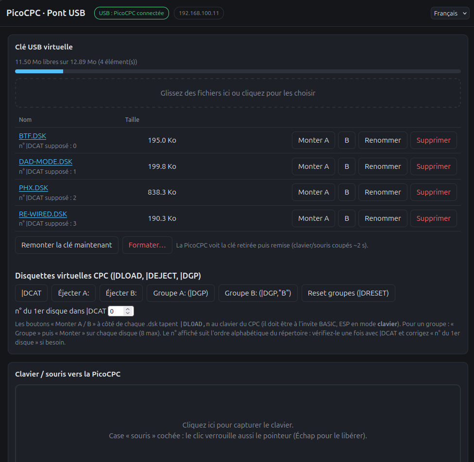
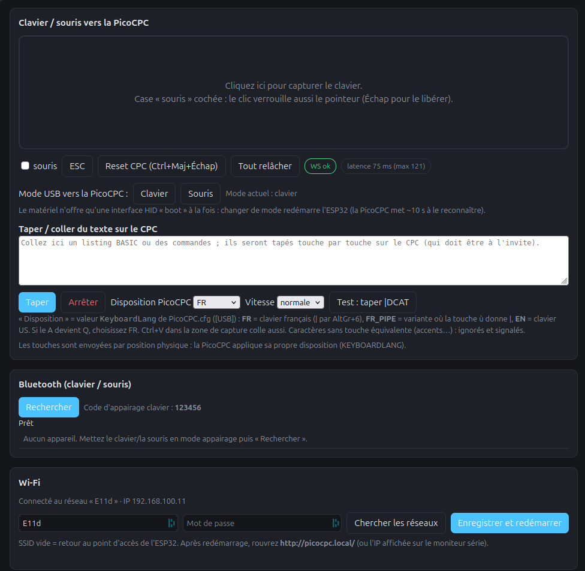
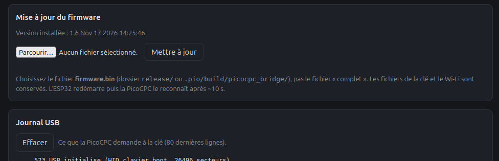

# PicoCPC USB Bridge (ESP32-S3)

[English](README.md) · **Français** · [Español](README_ES.md)

Un ESP32-S3 branché sur le port USB-A hôte d'une **PicoCPC** (Amstrad CPC) qui lui fournit :

* une **clé USB virtuelle** stockée dans la flash de l'ESP32 (FAT16, environ 12,9 Mio) : envoi, renommage et suppression de fichiers depuis une page web, avec l'espace libre affiché ;
* un **clavier et une souris USB** pour la PicoCPC, alimentés par un clavier/une souris **Bluetooth** appairés à l'ESP32, ou par une zone de capture de la page web ;
* une **saisie à distance** : collez un listing BASIC ou des commandes dans la page, l'ESP32 les tape touche par touche sur le CPC ;
* des **raccourcis disquettes virtuelles** : « Monter A / B » à côté de chaque `.dsk` (tape `|DLOAD,n`), éjection, groupes de disquettes (`|DGP`, `|DRESET`).

La page existe en **français, anglais et espagnol** (liste déroulante en haut à droite).

## Captures d'écran







## Matériel

* ESP32-S3 **DevKitC-1 N16R8** (16 Mo de flash, 8 Mo de PSRAM octale).
* La carte a deux ports USB-C :
  * port **UART** : flashage et moniteur série (à brancher à l'ordinateur) ;
  * port **USB** (natif) : à brancher au port USB-A de la PicoCPC avec un câble **de données** (USB-A → USB-C). La PicoCPC fournit le 5 V.
* Aucune carte microSD nécessaire : tout est en flash.

## Compilation et premier flashage (PlatformIO / VSCodium)

1. Ouvrez le dossier dans VSCodium/VS Code avec l'extension PlatformIO.
2. Facultatif : éditez `src/config.h` (SSID et mot de passe Wi-Fi, options). Sans réglage Wi-Fi, l'ESP32 crée le réseau **`PicoCPC-ESP32`** (mot de passe `picocpc1234`).
3. Branchez le port **UART** à l'ordinateur, puis *Upload* (`pio run -t upload`). La première fois, passez obligatoirement par PlatformIO : cela installe la table de partitions (2 emplacements de firmware + la clé).
4. Débranchez de l'ordinateur et reliez le port **USB** à la PicoCPC.
5. Ouvrez `http://picocpc.local/` (ou `http://192.168.4.1/` sur le réseau propre de l'ESP32). Le Wi-Fi se règle dans la page (carte « Wi-Fi »).

Après chaque compilation, le dossier **`release/`** est généré (voir ci-dessous).

## Mettre à jour le firmware

* **Depuis la page web** : carte « Mise à jour du firmware » → choisir `release/picocpc-usb-bridge-vX.Y-app.bin` (ou `.pio/build/picocpc_bridge/firmware.bin`) → *Mettre à jour*. L'image est vérifiée (ESP32-S3), écrite dans l'emplacement libre, puis l'ESP32 redémarre. Les fichiers de la clé et le Wi-Fi sont conservés.
* **Par câble (Windows / Linux / macOS)** : copiez le dossier `release/` où vous voulez, branchez le port **UART** et lancez `flash.bat` (Windows) ou `./flash.sh` (Linux/macOS). Python 3 est nécessaire ; `esptool` s'installe tout seul à la première utilisation. `flash.py --app` ne flashe que l'application ; `flash.py --erase` efface **tout** (clé et Wi-Fi compris).

## Utiliser la page web

| Carte | Rôle |
| --- | --- |
| **Clé USB virtuelle** | Glisser-déposer des fichiers, télécharger / renommer / supprimer, espace libre, *Remonter maintenant* (la PicoCPC voit la clé débranchée puis rebranchée et la relit), *Formater*. Les fichiers sont triés par ordre alphabétique, comme `|DCAT`. |
| **Disquettes virtuelles CPC** | `|DCAT`, éjecter A:/B:, groupe A:/B: (`|DGP`), reset des groupes (`|DRESET`). « Monter A / B » à côté d'un `.dsk` tape `|DLOAD,n[,"B"]`. « n° du 1er disque dans `|DCAT` » vaut `0` par défaut. |
| **Clavier / souris** | Cliquez dans la zone pour capturer votre clavier (cochez *souris* pour capturer aussi le pointeur ; Échap le libère). *Taper / coller du texte* envoie du texte touche par touche (Ctrl+V fonctionne aussi dans la zone). La latence du WebSocket est affichée. |
| **Bluetooth** | *Rechercher*, connecter, oublier. Code d'appairage des claviers : **123456** (`BLE_PASSKEY`). Les appareils appairés se reconnectent seuls. |
| **Wi-Fi** | Chercher les réseaux, régler SSID/mot de passe, enregistrer et redémarrer. SSID vide = retour au point d'accès de l'ESP32. |
| **Mise à jour du firmware** | Voir plus haut. |
| **Journal USB** | Les 80 dernières requêtes de la PicoCPC vers la clé. |

### Réglages côté PicoCPC

* La PicoCPC met **environ 10 s** à reconnaître l'ESP32 après la mise sous tension ou un *remontage*. Ne tapez pas `|DCAT` avant.
* « Disposition PicoCPC » dans la page doit correspondre à `KeyboardLang` de `PicoCPC.cfg` (`[USB]`) : **FR** (français ; `|` par AltGr+6), **FR_PIPE** (français, la touche `ù` donne `|`) ou **EN**. Si vous obtenez `Q` au lieu de `A`, choisissez **FR**.
* Le matériel ne permet **qu'une seule interface HID** : l'ESP32 est soit **clavier**, soit **souris** (boutons *Clavier / Souris*, l'ESP32 redémarre). Clavier par défaut.
* Clavier et souris utilisent le *protocole boot* standard (clavier = protocole 1, souris = protocole 2), car le firmware de la PicoCPC trie les périphériques selon ce protocole.

## Dépannage

| Symptôme | Cause / solution |
| --- | --- |
| `|DCAT` bloque ou ne fait rien juste après la connexion ou un remontage | Attendez ~10 s (la PicoCPC énumère encore). |
| Lettres fausses (`A` → `Q`), `|` absent ou `ù` affiché | Mauvaise « Disposition PicoCPC » : choisissez **FR** (ou **FR_PIPE**) comme dans `PicoCPC.cfg`. |
| Le texte tapé ne fait rien | L'ESP32 doit être en mode **clavier** et le CPC à l'invite BASIC. |
| L'ESP32 redémarre au lancement du Bluetooth | N'appelez jamais `WiFi.setSleep(false)` (incompatible avec le Bluetooth). Il n'est pas dans ce projet. |
| *Program size greater than maximum allowed* à la compilation | Le firmware doit tenir dans un emplacement de 1,5 Mo (`partitions.csv`). |
| La clé est illisible sur PC ou sur le CPC | *Formater* dans la page, ou maintenez le bouton **BOOT** de l'ESP32 pendant 3 s (reformate le volume). |
| Le clavier semble lent | Regardez la pastille *latence*. L'économie d'énergie Wi-Fi (imposée par le Bluetooth) ajoute du délai : connectez-vous au point d'accès propre de l'ESP32 pour la latence minimale. |
| Le flashage échoue | Utilisez le port **UART** (pas **USB**) ; maintenez BOOT, appuyez sur RESET, relâchez ; essayez `--baud 115200` ; Linux : `sudo usermod -aG dialout $USER`. |

## Organisation du projet

```
platformio.ini        environnement PlatformIO (espressif32 6.9.0, Arduino 2.0.17)
partitions.csv        nvs, otadata, app0, app1 (1,5 Mo chacune), disk (clé virtuelle)
src/config.h          Wi-Fi, options, version du firmware
src/main.cpp          serveur web, WebSocket, Wi-Fi, OTA, tâche d'entrée
src/usb_dev.cpp       USB : stockage de masse + HID boot sur mesure (clavier ou souris)
src/typer.cpp         moteur de saisie automatique (minutage régulier)
src/ble_hid.cpp       client Bluetooth HID (clavier/souris)
src/flashdisk.cpp     disque en flash avec cache d'écriture
src/fat16.cpp         FAT16 avec noms de fichiers longs
src/web_ui.h          la page web (fr/en/es)
tools/flash/          flasheur autonome (flash.py / .bat / .sh)
tools/release.py      génère release/ après chaque compilation
tools/hosttest/       tests PC du disque + FAT16
```
